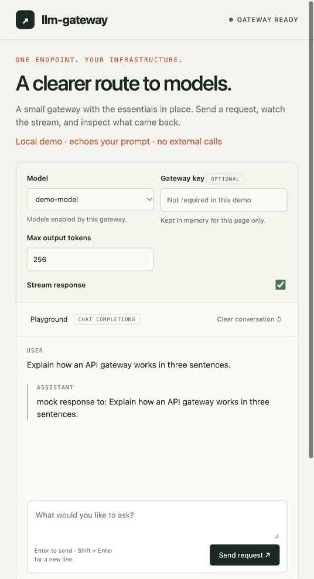
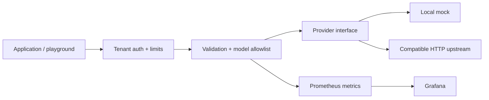

# llm-gateway

**A self-hosted chat API gateway in Go, with tenant keys, streaming, request limits and a built-in playground.**

Keep upstream credentials on the server, give each application its own key, and route text chat through one observable endpoint. Run the local demo without an account or connect an OpenAI-compatible upstream.



## Try it

Requires Go 1.25 or newer. No database, frontend build step or external account is needed.

```sh
go run ./cmd/gateway
```

Open **http://localhost:8080**. The default `mock` provider echoes your prompt locally; it does not generate model answers or make paid requests. The playground supports streaming, cancellation, conversation history and request statistics. Keys and history stay in page memory.

```sh
curl http://localhost:8080/v1/chat/completions \
  -H 'Content-Type: application/json' \
  -d '{"model":"demo-model","messages":[{"role":"user","content":"hello"}]}'
```

For a streamed response, add `"stream": true`. To receive token counts in the stream, also add `"stream_options": {"include_usage": true}`.

### With monitoring

```sh
docker compose -f deploy/docker-compose.yml up -d --build
```

| Service | Address |
| --- | --- |
| Gateway and playground | http://localhost:8080 |
| Prometheus | http://localhost:9090 |
| Grafana | http://localhost:3000 |

Grafana starts with a provisioned dashboard and local demo credentials `admin` / `admin`. Published ports bind to loopback. Stop with `docker compose -f deploy/docker-compose.yml down`; add `-v` only to discard monitoring data.

## Connect an upstream

The upstream must implement text-only `/chat/completions`, including SSE for streaming. Its base URL includes the API prefix, such as `/v1`. For example, with a local compatible model server already running:

```sh
export GATEWAY_PROVIDER=compatible
export GATEWAY_UPSTREAM_URL=http://127.0.0.1:11434/v1
export GATEWAY_MODELS=your-installed-model
# Generate the gateway tenant key; keep the output private.
export TENANT_KEY="$(openssl rand -hex 32)"
export GATEWAY_TENANTS="[{\"name\":\"portfolio\",\"key\":\"$TENANT_KEY\",\"rpm\":60,\"concurrency\":4}]"
# If the upstream requires authentication:
# export GATEWAY_UPSTREAM_KEY=...
go run ./cmd/gateway
```

Enter `TENANT_KEY` in the playground or pass `Authorization: Bearer <tenant-key>` in your client. The upstream key stays on the server. Compatible mode refuses to start without valid tenant configuration. `.env.example` documents the settings; the binary does not load `.env` files automatically.

The included Compose stack is a fixed, zero-configuration mock demo. For a live Compose deployment, explicitly pass the upstream and tenant variables in `gateway.environment`; `127.0.0.1` inside its container refers to that container, not the host.

## What it handles

- Text chat completions, JSON and server-sent events.
- Tenant bearer keys with independent request and concurrency limits.
- Model allowlist, strict request validation and a 1 MiB request body limit.
- Cancellation propagated upstream and a deadline covering the whole request.
- Upstream redirects refused to prevent credential forwarding.
- Bounded upstream JSON responses and stream event sizes.
- Consistent error envelopes, request IDs and structured logs without prompt bodies or keys.
- Liveness, readiness, graceful shutdown and container health checks.
- Prometheus request, latency, token, concurrency and streaming metrics.
- A responsive playground embedded in the binary, without third-party assets.

## API

| Method | Path | Access | Purpose |
| --- | --- | --- | --- |
| GET | `/` | Public | Playground; exposes enabled model IDs and provider mode |
| POST | `/v1/chat/completions` | Tenant key when configured | Text chat |
| GET | `/v1/models` | Tenant key when configured | Enabled models |
| GET | `/healthz` | Public | Process liveness and build version |
| GET | `/readyz` | Public | Local readiness; fails during shutdown |
| GET | `/metrics` | Optional metrics key | Prometheus exposition |

Supported request fields: `model`, `messages`, `stream`, `max_tokens`, `temperature`, `stream_options.include_usage`. Messages contain a string `content` and `system`, `user` or `assistant` role. Unknown fields are rejected to avoid silently dropping parameters. This is a deliberate subset of the chat protocol: tools, images, audio, multiple choices and the Responses API are outside this service's contract.

Errors use `{"error":{"message":"...","type":"..."}}`. Validation returns `400`, authentication `401`, tenant limits `429` with `Retry-After`, upstream failure `502`, and gateway deadline expiry `504`. `X-Request-ID` accompanies API responses. If a committed stream fails, the gateway emits a generic error event and closes without `[DONE]`; clients must treat a missing sentinel as incomplete.

## Configuration

| Variable | Default | Meaning |
| --- | --- | --- |
| `GATEWAY_PROVIDER` | `mock` | `mock` or `compatible` |
| `GATEWAY_UPSTREAM_URL` | empty | Compatible API base URL |
| `GATEWAY_UPSTREAM_KEY` | empty | Upstream bearer credential, if needed |
| `GATEWAY_MODELS` | `demo-model` | Comma-separated model allowlist |
| `GATEWAY_TENANTS` | empty | JSON array of `{name,key,rpm,concurrency}` |
| `GATEWAY_METRICS_KEY` | empty | Optional bearer key for `/metrics` |
| `GATEWAY_HTTP_ADDR` | `:8080` | Listen address |
| `GATEWAY_LOG_LEVEL` | `info` | `debug`, `info`, `warn`, `error` |
| `GATEWAY_REQUEST_TIMEOUT` | `60s` | Total API deadline, including streaming |
| `GATEWAY_READ_HEADER_TIMEOUT` | `10s` | Header read deadline |
| `GATEWAY_SHUTDOWN_TIMEOUT` | `15s` | Drain deadline |

Tenant names and keys must be unique, keys at least 24 characters long, and both limits positive. All authenticated API requests, including model listing and rejected chat requests, consume the tenant's request allowance. Fixed one-minute windows begin with the tenant's first request; concurrency slots are released on every exit path. Limits live in memory, apply per process and reset on restart. They are request controls, not financial budgets.

## Architecture



`cmd/gateway` owns startup and shutdown. `internal/config` validates environment settings. `internal/proxy` owns routing, access controls and response framing. `internal/providers` contains the mock and HTTP adapters. `internal/telemetry` owns an isolated Prometheus registry.

The gateway makes **one upstream attempt per request**. It does not automatically retry a request that may already have been billed. Streams are forwarded incrementally, and disconnects close the upstream body. Readiness describes the local process; it does not send paid requests to test the model provider.

## Verification

```sh
make test       # race detector and all tests
make lint       # go vet
make build      # bin/gateway
make docker     # distroless, non-root image
```

Tests exercise the HTTP adapter against local servers: auth forwarding, deadlines, redirects, malformed upstream responses, stream usage and truncation. Handler tests cover concurrent tenant limits, isolation, cancellation, model policy and HTTP errors. No real upstream credentials are needed. CI checks formatting, vet, race tests, container build and leaked secrets on pushes and pull requests.

See [operations](docs/operations.md) for deployment boundaries and [the demo walkthrough](docs/demo.md) for a short presentation.

## License

[Apache-2.0](LICENSE).
